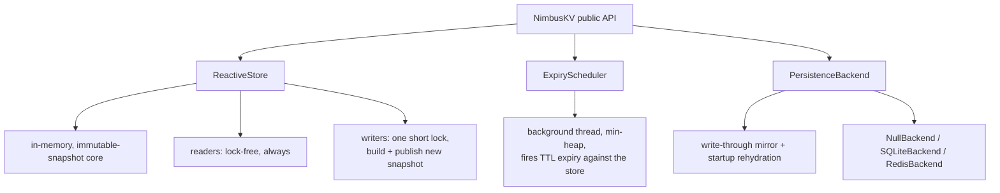

# NimbusKV v3.1.1

[](https://pypi.org/project/nimbuskv/)
[](https://pypi.org/project/nimbuskv/)
[](https://github.com/hemanshu03/NimbusKV/blob/latest/LICENSE)
[](https://github.com/hemanshu03/NimbusKV/actions/workflows/tests.yml)
[](https://py-free-threading.github.io/)

**Reactive, TTL-aware, concurrent key/value store for Python - lock-free reads always, one short lock per write, correct on both standard GIL Python and free-threaded Python (3.13t/3.14t).**

> **Free-threaded Python note:** NimbusKV depends on `immutables`, whose C extension has not yet declared free-threading support, so importing it re-enables the GIL on 3.13t/3.14t. Run with `PYTHON_GIL=0` (or `python -X gil=0`) to keep the GIL off. The NimbusKV test suite passes in that mode.

> **Renamed from `livedict`.** If you're upgrading: `pip uninstall livedict && pip install nimbuskv`, then change `from livedict import LiveDict` to `from nimbuskv import NimbusKV`. The API is otherwise unchanged.

---

## What changed in v3 (rewrite, not a patch)

v2 was a TTL dict with callbacks and a fake "sandbox" - a recombination of things `cachetools`/`aiocache` already do better. v3 is a different architecture:

* **Immutable-snapshot core** - state lives as an immutable persistent snapshot (HAMT). Readers never lock, ever. Each write takes one short lock, builds the new snapshot from the current one and publishes it. (Up to v3.0.1 writers retried on conflict instead; under a hot key that turned into a retry storm, so it was replaced.)
* **Adapts to the interpreter automatically** - same code path on standard GIL Python and free-threaded Python (3.13t/3.14t). No mode flag; detected once at import time.
* **Genuinely reactive** - `subscribe()` pushes every change (`set`/`delete`/`expire`) to callbacks, per-key or global.
* **Real async, not fake async** - for the in-memory path, `aget`/`aset` are truly non-blocking (no `run_in_executor` spent on work that was never I/O). When a persistence backend involves real I/O (SQLite/Redis), *only* that part is delegated to an executor.
* **`atomic()`** replaces v2's manual `lock()`/`unlock()` for compound read-modify-write (e.g. counters). Your function runs exactly once, under the write lock, so keep it short and don't write to the same store from inside it.
* **Persistence is a write-through mirror, not the source of truth** - Memory (default), SQLite, or Redis. Reads never touch the backend; it only exists for durability and startup rehydration.
* **`mset()`/`mget()`** - batch multiple keys into a single atomic swap (readers never see a partial update across related keys), plus a convenience multi-key read.
* **`wait_for()`** - block a thread until a condition on a key holds, driven by the subscription system, not polling. Built for producer/consumer coordination across threads.
* **Context manager support** - `with NimbusKV() as ld:` guarantees the scheduler and backend are cleanly stopped, even on exception.
* **TTL scheduler memory fix (3.1.1)** - rescheduling still invalidates the old deadline via a generation counter, and the scheduler now periodically compacts stale heap entries so repeated updates to a long-lived TTL cannot grow the heap without bound. Found during pre-release code review; covered by a regression test with 5,000 reschedules of one key.
* **`py.typed`** - ships as a properly typed package (PEP 561); type checkers (mypy/pyright) will pick up the annotations.
* **Sandbox dropped for this release.** v2's "sandbox" was a timeout wrapper, not real isolation, and calling it a sandbox was misleading. Real isolation (subprocess/WASM-based) is planned for a later release instead of shipping something that doesn't do what its name claims.

---

## Install

```bash
pip install nimbuskv
pip install "nimbuskv[redis]"   # only if you want the Redis backend
```

Works on Python 3.9+. For the lock-free write path, use a free-threaded build (3.13t/3.14t) - on standard GIL Python everything is still correct, just without the extra parallelism.

---

## Quick usage

```python
from nimbuskv import NimbusKV

ld = NimbusKV()  # in-memory, default
ld.set('foo', 123)
print(ld.get('foo'))  # 123
```

### TTL

```python
ld.set('temp', 'expire-me', ttl=2)
```

### Reactive subscriptions

```python
def on_change(key, event, old_value, new_value):
    print(key, event, old_value, '->', new_value)

sub = ld.subscribe(on_change)          # all keys
sub_foo = ld.subscribe(on_change, key='foo')  # just 'foo'

ld.set('foo', 1)     # -> foo set None -> 1
ld.delete('foo')     # -> foo delete 1 -> None
# TTL expiry fires its own 'expire' event, distinct from 'delete'
```

### Atomic compound updates (replaces manual locking)

```python
ld.set('counter', 0)
ld.atomic('counter', lambda v: v + 1)   # safe under concurrent writers, no lock held
```

### Batch operations

```python
ld.mset({'a': 1, 'b': 2})       # one atomic swap for both keys
ld.mget(['a', 'b', 'missing'])  # {'a': 1, 'b': 2, 'missing': None}
```

### wait_for - thread coordination without polling

```python
import threading

def consumer():
    result = ld.wait_for('job:status', lambda v: v == 'done', timeout=30)
    print('unblocked with:', result)

threading.Thread(target=consumer).start()
# ... elsewhere, another thread ...
ld.set('job:status', 'done')  # consumer's wait_for() returns right here
```

### Context manager

```python
with NimbusKV() as ld:
    ld.set('foo', 1)
# scheduler + backend cleanly stopped here, even if an exception was raised
```

### Async (genuinely non-blocking for the in-memory path)

```python
import asyncio
from nimbuskv import NimbusKV

async def main():
    ld = NimbusKV()
    await ld.aset('bar', 'hello')
    print(await ld.aget('bar'))

asyncio.run(main())
```

### Persistence backends

```python
ld = NimbusKV(backend='sqlite:/path/to/store.db')
# or
ld = NimbusKV(backend='redis://localhost:6379/0')
```

State is rehydrated from the backend on startup (already-expired keys are skipped).

---

## Architecture


---

## Status

v3.1.1 replaces the optimistic retry loop on the write path with a short lock, fixes several concurrency bugs, and compacts stale TTL heap entries when a key is rescheduled repeatedly (see `CHANGELOG.md`). Core, TTL, reactive subscriptions, atomic(), and all three persistence backends are implemented and tested for correctness (race-free under concurrent writers, verified with 10,000+ concurrent operations across 20 threads on standard Python - free-threaded benchmarks pending, to be published once run on a 3.14t interpreter).
Real sandboxing (proper isolation, not a timeout wrapper) is planned for a future release.

---

## Documentation

Full detailed docs, versioned:
- [`docs/v3.1.1.md`](docs/v3.1.1.md) - current release
- [`docs/v3.1.0.md`](docs/v3.1.0.md) - previous release
- [`docs/v3.0.0.md`](docs/v3.0.0.md) - original release (includes a known-issue note for anyone still pinned to it)
- [`dev/API_REFERENCE.md`](dev/API_REFERENCE.md) - full generated API surface, straight from the docstrings
- [`CONTRIBUTORS.md`](CONTRIBUTORS.md) - contributor credits

---

## Development / Contributing

```bash
git clone https://github.com/hemanshu03/NimbusKV.git
cd NimbusKV
pip install -e ".[dev]"
pytest tests/ -v
```

See [CONTRIBUTING.md](CONTRIBUTING.md) for guidelines, and the [`examples/`](examples/) folder for runnable end-to-end scripts. Free-threaded (3.13t/3.14t) testing is run in CI, but if you have a free-threaded interpreter locally, running the suite there too is especially valuable - that's the runtime this library's core claim is actually about.

---

## License

NimbusKV is licensed under the [Apache License 2.0](LICENSE). You can use it freely, including in commercial and closed-source products. If you redistribute it, keep the [`LICENSE`](LICENSE) and [`NOTICE`](NOTICE) files.

**License change:** versions up to and including 3.0.1 were released under the GNU GPL v3.0. From 3.1.0 onwards, NimbusKV is Apache-2.0. Copies of 3.0.1 and earlier that you already have remain under the GPL v3.0.

- [`NOTICE`](NOTICE): copyright and attribution
- [`TRADEMARKS.md`](TRADEMARKS.md): how you may use the NimbusKV name
- [`COMMERCIAL-LICENSING.md`](COMMERCIAL-LICENSING.md): terms beyond Apache-2.0 (no-attribution, warranty, support)
- [`CLA.md`](CLA.md): required for contributions

Copyright 2026 Hemanshu Vaidya.

---

## Support development

If NimbusKV is useful to you, consider supporting development:
👉 [NimbusKV on GitHub](https://github.com/hemanshu03/NimbusKV)
